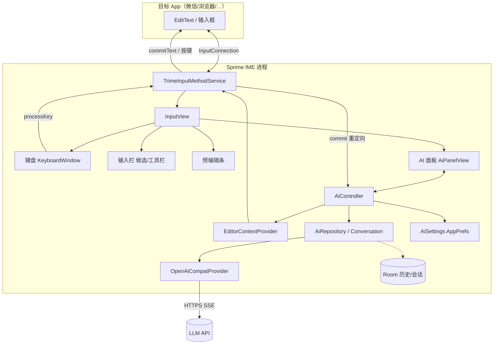
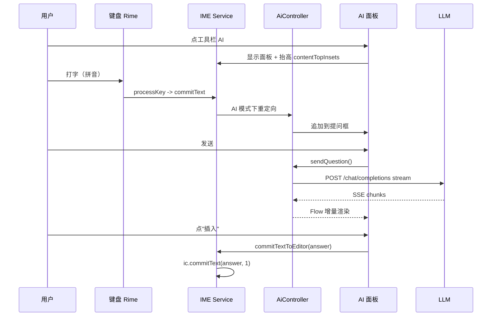

# Sprime 技术方案分析

> 基于 Rime / trime 的 Android 输入法，内嵌 AI 助手（不新开窗口）
> 参考实现：D:\IO\Android\trime（GPL-3.0-or-later，develop 分支，versionName 3.3.13）
> 目标工程：D:\IO\Android\Sprime（当前为空目录）
> 文档版本：v1 · 仅分析，尚未写码

---

## 0. 一页结论

| 问题 | 结论 |
|---|---|
| 怎么起步 | **Fork trime**，保留 Rime/librime 全部能力（拼音、方案、词库、主题、剪贴板），只在其上新增 AI 子系统。不从零写 IME，也不换掉 Rime。 |
| 怎么做到"不新开窗口" | 不新增任何窗口：AI 只是输入法窗口里的一个页面。**主方案见 §12**：IME 总高固定（比普通键盘多一条顶栏），页面在键盘与 AI 输出之间切换，insets 全程不变。 |
| 提问怎么输入 | **虚拟输入缓冲**：AI 模式下把 Rime 的"上屏"重定向到面板内的提问框（而不是目标 App），键盘和拼音仍照常工作。备选：选区/上下文一键动作（零输入）。 |
| 结果怎么用 | 点"插入/替换/复制"，走 `InputConnection.commitText`；替换原文时配合 `deleteSurroundingText`。 |
| AI 接口 | 先做 **OpenAI 兼容**（`/chat/completions` + SSE 流式），一套代码覆盖 DeepSeek / 通义 / Kimi / 智谱 / OpenAI / OpenRouter / Ollama / LM Studio。 |
| UI 技术 | 面板用 **原生 View + RecyclerView**（与现有栈一致，不引入 Compose 运行时）；设置页沿用 trime 的声明式 `AppPrefs`。 |
| 许可证 | trime 是 **GPL-3.0-or-later**，Sprime 必须同样 GPLv3 开源、保留版权头、分发时提供源码。这是硬约束，不是选项。 |
| 当前最大阻塞 | 不是代码，是**构建环境**：`compileSdk 37 / build-tools 37 / NDK 30 / CMake 3.31.6 / Gradle 9.8.1` 本机都没有，10 个 git submodule 全空，且仓库里的符号链接在 Windows 上退化成了文本文件。详见 §7。 |

**建议的 MVP（第一个可用版本）**：点工具栏 AI 键 → 面板从键盘上方升起 → 选区动作（翻译/润色/总结/解释/回复）+ 可自由提问 → 流式回答 → 一键插入。详见 §8。

---

## 1. 参考工程 trime 的结构勘察

252 个 Kotlin 文件、约 2 MB 源码；C++ 侧是 librime + librime-lua + octagram + predict + snappy 的 JNI 封装。

### 1.1 目录与职责

| 路径 | 职责 | 与 AI 功能的关系 |
|---|---|---|
| `ime/core/TrimeInputMethodService.kt`（1030 行） | IME 生命周期、输入连接、上屏、按键转发、insets | **核心改造点**：上屏 `commitText()`（L609）、组合文本 `updateComposingText()`（L947）、编辑器取文 `getActiveText()`（L963）、insets `onComputeInsets()`（L479）、窗口尺寸 `onConfigureWindow()`（L527） |
| `ime/core/InputView.kt`（388 行） | 键盘视图树 + Kodein DI 容器 | 面板要挂进这棵树；DI 里注册 AI 相关单例 |
| `ime/window/BoardWindow.kt` / `BoardWindowManager.kt` / `ResidentWindow.kt` | 键盘区内"页面"抽象（键盘/符号/剪贴板/开关页），借鉴 fcitx5-android | 若要"整块替换键盘区"的页面式面板，直接实现一个 `BoardWindow` |
| `ime/bar/InputBarDelegate.kt` + `ime/bar/ui/AlwaysUi.kt` | 键盘上方那条候选/工具栏（候选词、剪贴板提示、工具按钮） | AI 入口按钮可以放这里（走主题 `tool_bar.buttons`） |
| `ime/keyboard/CommonKeyboardActionListener.kt` | 所有按键行为/命令分发 | `handleFunctionCommand()`（L178）里加一条 `ai_assistant` 命令，任意主题按键即可触发 |
| `ime/composition/PreeditDelegate.kt` | 组合（拼音）预览条 | 提问时的拼音预览靠它；它用 `TouchEventReceiverWindow` 解决"键盘上方不可点"的问题（见 §2.1） |
| `daemon/RimeDaemon.kt` / `RimeSession.kt` | Rime 单例 + 会话，进程内运行 | AI 面板与 Rime 同进程，无需 IPC；网络请求也在该进程 |
| `core/Rime.kt` + `jni/librime_jni/*.cc` | JNI 绑定（`System.loadLibrary("rime_jni")`） | **不改 native**，AI 全在 Kotlin 侧 |
| `data/prefs/AppPrefs.kt` | 声明式偏好（switch/int/enum/list），自动生成设置界面 | 新增 `AppPrefs.Ai` 分组 + 一个 Fragment 就是完整设置页 |
| `data/theme/` | 主题 YAML 模型（`style / tool_bar / preset_keys / preset_keyboards`） | 面板配色复用 `ThemeScope.colors`，随主题切换 |
| `build-logic/` | 约定插件：ABI 拆分、NDK/CMake 版本、OpenCC 数据、数据校验和 | 构建配置改动都在这里 |

### 1.2 关键事实（已逐条核对源码）

1. **IME 窗口是全屏的**：`onConfigureWindow` 里 `win.setLayout(MATCH_PARENT, MATCH_PARENT)`。
2. **"键盘顶部"由 insets 上报**：`onComputeInsets` 取 `inputView.keyboardView` 在窗口中的 y 坐标作为 `contentTopInsets / visibleTopInsets`。
3. **insets 之上的区域收不到触摸**：证据是 PreeditDelegate 专门为悬浮在键盘上方的预编辑条挂了一个 `PopupWindow`（`TouchEventReceiverWindow`）转发触摸。→ 面板要可点，必须把 `contentTopInsets` 抬高，或同样用触摸桥。
4. **上屏只有两个咽喉**：`commitText()`（文本）与 `sendDownUpKeyEvent()`（按键；ASCII 模式下字母直接走这条）。
5. **主题按键可调用任意命令**：`{command: ...}` → `handleFunctionCommand` 的 `when` 分支。
6. **构建链硬版本**：AGP 9.4.1 / Kotlin 2.3.21 / Gradle 9.8.1 / NDK 30.0.16248370 / CMake 3.31.6 / compileSdk 37 / minSdk 21。

---

## 2. 七个关键设计判断

### 2.1 面板放在哪：三种形态

| 形态 | 做法 | 优点 | 代价 |
|---|---|---|---|
| **A. 键盘上方浮层**（推荐） | `InputView` 中 `keyboardView` 上方插入 `aiPanel`；显示时 `contentTopInsets = aiPanel.top` | 键盘/候选/拼音预览全部保留，可边看答案边打字；最像"输入法内嵌助手" | 需主动触发一次 insets 重算（`updateInputViewShown()`），不同 ROM 要验证 |
| B. 替换键盘区 | 实现一个 `BoardWindow`（如 LiquidWindow），面板占满键盘高度 | 零 insets 改动，与现有页面机制一致 | 面板高度受限；提问时要么没键盘，要么得自绘小键盘 |
| C. 独立 PopupWindow | 仿 `TouchEventReceiverWindow` | 不改 insets | 弹窗抢焦点/盖住 App、易被回收，且"新开窗口"的观感与原需求相悖 |

**结论**：~~MVP 用 A~~ → 后续讨论后改为 **§12 的固定高度方案**（B 的强化版：总高锁定、顶栏 + 页切换），A 仅作为可选增强。
**验证点（M0 就要做的一次性 spike）**：真机上显示面板 → 面板可点、App 内容被顶起、光标不被遮挡、收起后恢复。

### 2.2 提问怎么输入：三方案对比

| 方案 | 用户操作 | 实现 | 风险 |
|---|---|---|---|
| **A. 上下文动作（零输入）** | 选中文字 → 点"翻译/润色/总结/解释/回复" | 读 `getSelectedText` / `getTextBeforeCursor`，直接发请求 | 无。**MVP 必做**，价值最高 |
| **B. 虚拟输入缓冲**（推荐主路径） | 点 AI → 面板出现提问框 → 用现有键盘打字（拼音可用）→ 发送 | AI 模式下把 Rime 上屏**重定向**到面板 buffer：`commitText`、`sendDownUpKeyEvent`、`updateComposingText`、`handleReturnKey` 四处挂钩 | 需处理退格/方向键/回车/ASCII 直通等边界 |
| C. 面板内放真 `EditText` | 点输入框获得焦点后打字 | 原生控件，编辑体验完整 | IME 窗口通常不持有焦点，`EditText` 可能既收不到按键又引发窗口/输入连接异常；ROM 差异大。**不推荐** |

**B 的关键细节**（必须写进实现）：
- 中文路径走 `commitText()`，天然好拦。
- **ASCII 模式不走 commitText**：`processKey` 返回 `KeyMessage` 后 `sendDownUpKeyEvent()` 直接发给编辑器。必须在此处优先用 `KeyEvent.getUnicodeChar(meta)` 取字符并追加到 buffer。
- 退格：`KEYCODE_DEL` → 删 buffer 末字符（组合态由 Rime 自己消化，不会到这里）。
- 回车：`handleReturnKey()` → AI 模式下改为"发送"。
- 方向键：buffer 内移动光标（MVP 可先只支持追加/退格）。
- 若用户开了 `inline_preedit`，拼音会出现在 App 输入框里：进入 AI 模式时强制 `finishComposingText()`，仅用预编辑条展示。
- 退出 AI 模式时清空 buffer、摘掉 sink，避免"文本跑到 App 里"。

### 2.3 结果上屏

- 插入到光标：`commitText(answer, 1)`（AI 需绕过自己的 sink，用显式 `commitTextToEditor`）。
- 替换选区：`commitText` 本身会替换选区，无需先删。
- 替换"我刚打的提问"：面板保存提问长度，`deleteSurroundingText(len, 0)` 后 commit。
- 撤销：trime 已有 Ctrl+Z hook（`hookCtrlZY`），"撤销"按钮可直接复用 `performContextMenuAction(android.R.id.undo)`。
- 某些 WebView / Compose 输入框 `getSelectedText` 返回 null：降级为"取光标前 N 字符"。

### 2.4 网络层

- **OkHttp 5 + 手写 SSE**（逐行解析 `data: {...}`），比引第三方 SDK 稳、体积小；`Flow<AiDelta>` 向上抛，UI collect。
- 取消：`Call.cancel()` 配合 `Job.cancel()`；面板提供"停止"。
- 超时：connect 10s / 首 token 30s / 流式按 chunk 计时。
- 重试：仅对 429/5xx 做一次指数退避；流式中途失败保留已收内容。
- 线程：`Dispatchers.IO`，结果回主线程；IME 主线程绝不阻塞。
- 进程：`InputMethodService` 与 App 同进程，无需 ForegroundService；但要防系统冻结，必须有超时兜底。

### 2.5 Provider 抽象

```kotlin
interface AiProvider {
    val id: String
    suspend fun chat(req: ChatRequest): Flow<ChatDelta>
}
```

- **v1 只做 OpenAI 兼容**：POST `{baseUrl}/chat/completions`，`Authorization: Bearer`，`stream: true`。
- 预设清单（baseUrl + 默认模型）：DeepSeek、通义千问（兼容模式）、Kimi、智谱、OpenAI、OpenRouter、硅基流动、Ollama（http://127.0.0.1:11434/v1）、LM Studio。
- v1.1 再加 Anthropic Messages 与 Gemini 原生（请求体形状不同）。
- 代理 / 自定义 UA / 额外 header 留成设置项，便于接企业网关。

### 2.6 上下文与隐私

来源优先级：选区 > 光标前 N 字符 > 光标后 N 字符 > 剪贴板 > Rime 当前组合。
附加：`EditorInfo.inputType / imeOptions / packageName + 应用名`（用于"回复建议"判断是聊天框还是搜索框）。

硬性守卫：
- 密码类 `inputType`（`*_VARIATION_PASSWORD`、`TYPE_NUMBER_VARIATION_PASSWORD`、`TYPE_TEXT_VARIATION_WEB_PASSWORD`）→ AI 入口置灰、清空上下文、绝不上传。
- 默认不上传剪贴板；需用户显式勾选。
- 面板内"隐私模式"开关（本次不记录历史、不带上文）。
- 默认不落盘 prompt/回答；历史若要做，单独开关 + 本地 Room + 一键清空。

### 2.7 UI 技术选型

| 选项 | 结论 |
|---|---|
| Compose | 面板用 Compose 体验最好，但当前工程**没有 Compose 依赖**，引入约 +2–3 MB 与启动成本；IME 进程本已很重（librime + opencc）。另外 `ComposeView` 需要 ViewTree 三个 owner，得在 Service 上补齐。 |
| **原生 View（推荐）** | 与 `splitties-views-dsl` 一致；RecyclerView + TextView 足够做流式输出，`SpannableStringBuilder` 增量追加即有打字机效果。 |

结论：MVP 用原生 View；设置页用现有 `PreferenceDelegateFragment`。

---

## 3. 总体架构



**一次提问的时序**



---

## 4. 文件级改动清单

### 4.1 新增（放在 `com.osfans.trime.ai` 与新子包下）

```text
app/src/main/java/com/osfans/trime/
├── ai/
│   ├── AiController.kt            // 面板状态机 + 上屏重定向 sink + 生命周期
│   ├── AiSettings.kt              // 读 AppPrefs.Ai；密钥走 Keystore/EncryptedSharedPreferences
│   ├── model/
│   │   ├── ChatMessage.kt
│   │   ├── ChatRequest.kt
│   │   └── AiDelta.kt             // Delta / Done / Error
│   ├── provider/
│   │   ├── AiProvider.kt
│   │   ├── OpenAiCompatibleProvider.kt
│   │   ├── SseParser.kt           // 纯函数，可单测
│   │   └── ProviderPresets.kt
│   ├── prompt/
│   │   ├── AiAction.kt            // TRANSLATE/POLISH/SUMMARIZE/EXPLAIN/REPLY/CONTINUE/CUSTOM
│   │   └── PromptBuilder.kt       // 模板 + 上下文注入 + 截断
│   ├── context/EditorContextProvider.kt
│   └── store/AiHistoryDao.kt      // Room（v1.1）
├── ime/ai/
│   ├── AiPanelView.kt             // 根容器（ChipRow + ComposeBar + AnswerList + ActionRow）
│   ├── AiComposeBar.kt            // 自绘 caret + 文本缓冲
│   ├── AiAnswerAdapter.kt         // RecyclerView，流式增量
│   ├── AiChipBar.kt
│   ├── AiInputSink.kt             // 接管 KeyMessage/commit/回车/退格
│   └── AiWindow.kt                // 可选：形态 B 时用的 BoardWindow
└── ui/main/settings/AiSettingsFragment.kt
```

### 4.2 修改（最小必要）

| 文件 | 改动 |
|---|---|
| `AndroidManifest.xml` | 加 `<uses-permission android:name="android.permission.INTERNET"/>`；`android:label` 改 Sprime；可选 `usesCleartextTraffic` / network security config |
| `ime/core/InputView.kt` | ① DI 注册 `AiController`；② `keyboardView` 上方插入 `AiPanelView`（默认 GONE）；③ 主题切换时刷新面板配色 |
| `ime/core/TrimeInputMethodService.kt` | ① `onComputeInsets` 计入面板高度；② `commitText` / `updateComposingText` 前置 sink 判断；③ `handleRimeMessage` 的 KeyMessage 分支交给 sink；④ 暴露 `getEditorContext()`；⑤ `onFinishInputView` 取消进行中的请求 |
| `ime/keyboard/CommonKeyboardActionListener.kt` | `handleFunctionCommand` 增加 `ai_assistant` → `aiController.togglePanel()` |
| `data/prefs/AppPrefs.kt` | 新增 `class Ai : PreferenceDelegateOwner`（enabled / provider / baseUrl / model / temperature / maxTokens / systemPrompt / contextEnabled / contextChars / historyEnabled / allowCleartext / showToolbarButton） |
| `app/build.gradle.kts` + `gradle/libs.versions.toml` | 加 okhttp（Room 已有） |
| `assets/shared/trime.yaml`（或自带主题） | `preset_keys` 加 `AI: {label: AI, command: ai_assistant}`；`tool_bar.buttons` 加一枚 AI 按钮 |
| `res/values*/strings.xml` | 新文案（中/英） |
| 导航图 / 设置入口 | 新增"AI 助手"设置页 |
| `res/mipmap*`、`values/strings.xml(app_name)` | 更名为 Sprime |

> **v1 不改 Kotlin 包名**（仍是 `com.osfans.trime`），只把 `applicationId` 改成 `com.sprime.ime`、换应用名与图标。原因：JNI 里是 `Java_com_osfans_trime_...` 硬符号，整包重命名要同步改 C++（约 40 处）+ 252 个 Kotlin 文件 + 资源 + R8 规则，风险大收益低，放到 M6 单独做。

---

## 5. 交互设计

### 5.1 面板状态机

```text
Closed --点 AI/快捷键--> Compose --发送--> Streaming --完成--> Done
   ^                        ^                 |                |
   +----关闭/插入---- Done <-+---- 停止 -------+                |
                            +------- 重试/追问 ----------------+
```

### 5.2 布局（面板在键盘上方）

```text
+------------------------------- 面板（可滚动，约 30-45% 屏高）-------------------------------+
| [翻译][润色][总结][解释][回复][+ 自定义]                        [隐私模式] [x] |
| +-- 提问框 -------------------------------------------------------------+ |
| | 把这段话翻译成英文，语气正式一点…                              [发送 >] | |
| +-----------------------------------------------------------------------+ |
| -- 回答（流式）---------------------------------------------------------- |
| Sure, here is a more formal version: ...                                  |
| [插入] [替换原文] [复制] [重试] [追问]                                     |
+---------------------------------------------------------------------------+
   ^ 预编辑条（拼音） + 候选栏（现有 InputBar）
+------------------------------- 现有键盘 ----------------------------------+
```

### 5.3 入口（三选一 + 组合）

1. **工具栏按钮**（主题 `tool_bar.buttons`）：所有主题通用性最好，自己可控。
2. **键盘按键**（`preset_keys` + `preset_keyboards`）：放在候选栏右侧或回车键长按。
3. **手势**：空格左/右滑（需改 `KeyBehavior`，v1.1 再做）。

MVP 只做 1 + 自带主题里的 2（第三方主题不带 AI 键也不影响，工具栏按钮仍在）。

### 5.4 动作与提示词（PromptBuilder）

| 动作 | 输入 | 提示词要点 |
|---|---|---|
| 翻译 | 选区/上文 | 指定目标语言，只输出译文，保留段落 |
| 润色 | 选区/上文 | 保持原意，输出改写结果 + 可选"说明改动" |
| 总结 | 选区/整段 | 3 条要点，不超过 N 字 |
| 解释 | 选区 | 面向普通读者 |
| 回复 | 上文（聊天） | 生成 3 条候选回复，风格可切换 |
| 续写 | 光标前文 | 与原文语气一致，限制长度 |
| 自定义 | 用户提问 + 上下文 | 直通 |

上下文注入统一格式：`[system] 你是…` + `[user] <上下文>` + `---` + `<指令>`，并对上下文做字符级截断（默认 2000 字，可配）。

---

## 6. 安全与合规

### 6.1 GPLv3（硬约束）

- Sprime 全部源码必须以 **GPL-3.0-or-later** 发布；分发 APK 时必须提供对应源码（公开仓库即可）。
- 保留 trime / Rime community 的版权头（每个文件顶部 SPDX），新增文件同样加 `SPDX-License-Identifier: GPL-3.0-or-later`。
- 不能只发二进制；不能加限制性 EULA；专利授权条款自动授予用户。
- 主题/词库（`assets/shared/*`，来自 rime-prelude / luna-pinyin / stroke / essay）各自许可证一并保留（prelude 为 Apache-2.0，与 GPLv3 兼容）。
- 想闭源就只能不用 trime/librime 重写，等于重做一个输入法，不建议。
- 名称：`Sprime` 需自查商标；不要沿用 trime 图标/名称造成混淆。

### 6.2 Google Play 相关

- 键盘类应用有专门的用户数据政策：必须声明收集哪些数据、用途、是否与第三方共享（AI 请求必然把用户文本发给第三方）。
- 若以"AI 生成内容"为卖点，需遵守生成式 AI 内容政策（提供举报入口、内容安全）。
- `targetSdk` 跟 trime 走，Play 对新应用有最低 targetSdk 要求。
- 建议首次启动做一次 **AI 功能隐私告知**（明确"文本会发送到你配置的服务商"），并默认关闭、用户手动开启。

### 6.3 技术安全

- API Key 存 `EncryptedSharedPreferences`（androidx.security.crypto）或 Keystore 加密后落盘；不写日志。
- 日志过滤：请求/响应 body 一律不进 Timber；只记状态码与耗时。
- 剪贴板 / 密码框守卫（§2.6）。
- 服务商走 TLS；`allowCleartext` 默认 false，打开时 UI 明确警示。
- 输入法权限极高（能看到所有输入），任何遥测都要可选且明示。

---

## 7. 构建环境现状（实测）

| 项 | trime（develop）要求 | 本机现状 | 结论 |
|---|---|---|---|
| JDK | 11 target（AGP 9 需 17+） | Temurin 21.0.12 | OK |
| Gradle | 9.8.1（wrapper） | 仅 D:\IO\gradle = 8.10.2，无 wrapper 缓存 | 首次构建需联网下载约 130 MB |
| AGP / Kotlin | 9.4.1 / 2.3.21 | — | 需 Maven 拉取 |
| compileSdk / buildTools | 37 / 37.0.0 | platforms 34、35；build-tools 25/34/35 | **缺** |
| NDK | 30.0.16248370 | 26.1.10909125、27.0.12077973 | **缺**（或改版本覆盖） |
| CMake | 3.31.6 | 3.22.1 | **缺**（或改版本覆盖） |
| submodule | 10 个（librime / lua / octagram / predict / snappy / rime 数据） | **全部为空** | **缺**，必须 git submodule update --init --recursive（数百 MB） |
| 符号链接 | assets/shared/* 指向 app/data/rime/*（mode 120000） | Windows core.symlinks=false，退化成了"内容是一行路径"的普通文本 | **致命**：不修就是一堆坏 yaml |

### 7.1 两条路线

**路线 A：完整源码构建（正统，慢）**

```powershell
# 1) 复制/克隆工程（保留 git 历史，便于同步上游与合规说明）
git clone D:\IO\Android\trime D:\IO\Android\Sprime
cd D:\IO\Android\Sprime

# 2) 修复符号链接（二选一）
git config core.symlinks true      # 需要 Windows 开发者模式或管理员
git checkout -- app/src/main/assets/shared
# 或用脚本把每个链接文件替换为真实文件副本

# 3) 拉齐 submodule（需要网络）
git submodule update --init --recursive

# 4) 补 SDK 组件
sdkmanager "platforms;android-37" "build-tools;37.0.0" "ndk;30.0.16248370" "cmake;3.31.6"

# 5) 构建
.\gradlew.bat :app:assembleDebug
```

首次 native 构建（librime + opencc + leveldb + marisa + snappy，4 个 ABI）非常慢；建议用 -PbuildAbi=arm64-v8a 或环境变量 BUILD_ABI 只编一个 ABI。

**路线 B：预编译 native（快，适合先做 UI/AI 原型）**

```text
从官方 trime APK 里取出 lib/<abi>/librime_jni.so，放到：
  app/prebuilt/<abi>/librime_jni.so
NativeBaseConventionPlugin 检测到 app/prebuilt 就会跳过 CMake（见其源码 L29-38）
```

注意：仍需 assets/shared 的 Rime 数据（可从 APK 的 assets 里拷）与 compileSdk/buildTools。适合先把面板与 AI 链路跑通；要改 native（基本不会）再回路线 A。

**建议**：先用 B 做两周原型，同时后台跑 A 的 submodule 与 SDK 下载。

### 7.2 版本基线选择

| 基线 | compileSdk | NDK | 备注 |
|---|---|---|---|
| develop（3.3.13） | 37 | 30 | 功能最新；SDK 37 较新 |
| v3.3.12 tag | 36 | 28 | 更稳，建议作为 Sprime v1 的基线 |

> 建议：Sprime 从 **v3.3.12** 起分支，保留 upstream 远程指向 trime，定期 merge，既好跟进也能在 README 里说清来源（GPL 合规更清晰）。

---

## 8. 里程碑

| 阶段 | 内容 | 验收 | 预估 |
|---|---|---|---|
| **M0 跑通基线** | 克隆、修符号链接、submodule、SDK，出可安装 APK；真机能打字 | 打字/候选/切方案正常 | 1–3 天（下载为主） |
| **M0.5 面板 spike** | 键盘上方插入空面板 + contentTopInsets 调整 + 开关动画 | 面板可点、App 被顶起、收起复原；3 个品牌 ROM 验证 | 1–2 天（**风险最高，先做**） |
| **M1 AI 链路** | 设置页（provider/key/model）、OpenAiCompatibleProvider + SSE、面板流式显示 | 填 key 后能收到流式回答 | 3–5 天 |
| **M2 上下文动作** | 选区/上文读取、动作 Prompt、插入/替换/复制 | 微信/浏览器/备忘录里翻译与润色可用 | 2–3 天 |
| **M3 自由提问** | AiInputSink（重定向 commit/按键/回车/退格）、发送 | 用拼音提问，文本只进面板不进 App | 3–5 天 |
| **M4 打磨** | 多轮追问、重试/停止、历史、隐私模式、密码框守卫、配色随主题、首次告知 | 通过附录清单 | 3–5 天 |
| **M5 发布** | 更名/图标/引导、GPL 源码与声明、隐私政策、商店合规 | 可发布 | 2–3 天 |
| **M6 可选** | 整包重命名、语音输入、InlineSuggestions 做 AI 联想、本地小模型 | — | — |

---

## 9. 风险清单

| # | 风险 | 影响 | 对策 |
|---|---|---|---|
| 1 | 面板 insets 重算在部分 ROM 不生效/抖动 | 面板不可点或布局跳动 | M0.5 先验证；备用形态 B；再退 TouchEventReceiverWindow |
| 2 | ASCII 输入绕过 commitText | 英文提问跑到 App 里 | 在 sendDownUpKeyEvent 与 handleReturnKey 同时挂钩 |
| 3 | 网络慢/被墙 | 用户以为卡死 | 首 token 超时提示、可取消、服务商可切国内/自建 |
| 4 | 隐私争议（输入法 + 上传文本） | 下架/差评 | 默认关闭、显式告知、密码框禁用、隐私模式、本地模型选项 |
| 5 | GPL 违约 | 法律风险 | 仓库公开、保留头、README 声明来源与许可 |
| 6 | 构建链过重 | 新人上手难 | 固化脚本/CI、预编译 native 兜底 |
| 7 | 主题兼容 | 第三方主题没有 AI 键 | 工具栏按钮兜底 + 设置项强制显示 |
| 8 | 成本失控 | 用户账单 | 显示 token 用量、限制 max_tokens、预算提示 |
| 9 | 上游合并冲突 | 维护成本 | AI 代码全放新包，对上游文件改动控制在 8 个左右，尽量加钩子而非改逻辑 |

---

## 10. 需要拍板的 5 件事（括号内是我的建议）

1. **基线**：v3.3.12 tag 起分支（推荐），还是直接跟 develop？
2. **包名**：v1 只改 applicationId=com.sprime.ime、保留 com.osfans.trime（推荐），还是立刻整包重命名？
3. **AI 服务商**：v1 只做 OpenAI 兼容 + 预设（推荐），还是同时做 Anthropic / Gemini 原生？
4. **数据策略**：默认不保存历史、默认不上传剪贴板（推荐），还是提供云同步？
5. **面板形态**：A 键盘上方浮层（推荐）先做，还是直接做 B 占屏页？

---

## 11. 窗口可检测性（风控 / 反作弊视角）

### 11.1 先给结论

| 问题 | 答案 |
|---|---|
| 会被识别成"悬浮窗"吗？ | **方案 A 不会。** 没有新增窗口、没有 overlay 权限、没有第二个 window token；系统窗口列表里仍然只有那个 `InputMethod` 窗口，只是它"长高"了。 |
| 会被识别成"普通输入法"吗？ | **会，而且最多只能识别到这一层**：当前 IME 的包名/服务名。任何输入法都暴露，无法隐藏。 |
| 会被看出"键盘变高了"吗？ | **会。** 这是方案 A 唯一明显的外部副作用，App 通过 insets 就能测到。 |
| 会被看到面板里的内容吗？ | 普通 App **看不到**；只有屏幕捕获（需用户授权）、无障碍服务（需用户开启）、root/adb 才能看到。 |

一句话：**对普通 App 来说，Sprime 只是一个"键盘比别人高"的输入法，不是悬浮窗。**

### 11.2 谁能看到什么

普通 App（无任何特殊权限）**能**拿到：
- `Settings.Secure.DEFAULT_INPUT_METHOD` → 当前输入法包名/服务名（所有 IME 通用）
- `InputMethodManager.getEnabledInputMethodList()` / `getCurrentInputMethodSubtype()`
- `WindowInsets.Type.ime()` / `getWindowVisibleDisplayFrame` / `OnGlobalLayoutListener` → **IME 高度**
- Android 11+ 的 `WindowInsetsAnimation.Callback` → 高度变化过程
- `MotionEvent.getFlags()` 里的 `FLAG_WINDOW_IS_OBSCURED`（只在"有别的窗口压在它上面且触摸落到它身上"时才置位）

普通 App **不能**：
- 枚举其他 App 的窗口（无公开 API）
- 查询其他 App 的 `SYSTEM_ALERT_WINDOW` 权限（AppOps 只允许查自己）
- 读取我们面板的 View 树 / 文本

系统与开发工具能：
- `adb shell dumpsys window` / `dumpsys input` 看到窗口类型、包名、frame、touchableRegion
- 无障碍服务能枚举窗口（类型 + 包名），但看到的是**一个 IME 窗口**，不是"AI 面板"

### 11.3 三种形态的可观测性对比

| 观测点 | A 键盘上方浮层 | B 键盘区内换页 | C 独立悬浮窗 |
|---|---|---|---|
| 新增系统窗口 | 无 | 无 | **有**（`TYPE_APPLICATION_OVERLAY` / `APPLICATION_PANEL`） |
| 需要 overlay 权限 | 否 | 否 | **是**（`SYSTEM_ALERT_WINDOW`） |
| 系统设置里出现"显示在其他应用上层" | 否 | 否 | **是**（用户可见） |
| IME 高度变化 | **有**（明显） | 无 | 无（IME 不变，但多一个窗口） |
| 触摸遮蔽标志 `FLAG_WINDOW_IS_OBSCURED` | 与普通键盘一致（待实测） | 同左 | **可能触发**，正是 tapjacking 检测的经典信号 |
| 无障碍可枚举 | 只看到 IME 窗口 | 同左 | 能看到额外窗口 |
| Play 审核 | 无额外要求 | 无 | 有额外限制 |

> 这也是我把 C 排除的主因：一旦用真悬浮窗，就从"普通输入法"变成了"需要 overlay 权限的覆盖层"，而覆盖层正是银行/反作弊 SDK 重点盯的东西。

### 11.4 真正会挡住你的，通常不是"悬浮窗检测"

- **银行/政务 App 直接禁用第三方输入法**：`setShowSoftInputOnFocus(false)` + 自绘安全键盘 → Sprime 根本弹不出来，AI 面板无从谈起（这是最常见的一种"检测"，但它检测的是"你不是系统输入法"）。
- 少数 App 校验 `DEFAULT_INPUT_METHOD` 白名单 → 提示"请切换系统输入法"。
- 游戏/反作弊对"非系统 IME"敏感。
- 对策：在密码/支付类输入框里**主动降级**——不显示 AI 入口、insets 保持与纯键盘一致，必要时直接切回纯键盘页（形态 B 的 insets 完全不变，最不引人注意）。

### 11.5 降低可观测性的工程手段

1. 面板高度设上限（例如 ≤ 键盘高 × 1.3），或用形态 B（面板占键盘区，**insets 完全不变**）。
2. 显隐走 insets 动画，不要瞬移。
3. 不申请 overlay / 无障碍 / 截屏权限；不用 `PopupWindow` 盖在 App 内容上。
4. 保持 `adjustResize` 语义：面板占据空间时让 App 重排，而不是盖在它上面。
5. 密码框 / `TYPE_NULL` / 安全键盘场景：自动收起面板。

### 11.6 待实测清单（并入 M0.5）

1. 面板展开前后，App 侧 `getRootWindowInsets().getInsets(Type.ime()).bottom` 的数值差
2. 触摸 App 区域时 `event.flags & FLAG_WINDOW_IS_OBSCURED` 是否被置位（IME 是否算"可信覆盖层"这一点，各家 ROM 可能有差异，必须实测）
3. `adb shell dumpsys window` 里窗口数量/类型在面板前后是否变化
4. 开一个无障碍服务 App，看它能否区分"面板"与"键盘"
5. 银行/支付类 App 里验证：面板是否会被安全键盘挤掉、是否触发风控提示

> 结论回到工程上：**只要不新开窗口，就不存在"被检测出悬浮窗"这件事**；能暴露的只有"输入法是谁"和"键盘多高"。前者是所有输入法的共性，后者可以用形态 B 或高度上限抹平。

---

## 12. 定稿形态：固定高度的 IME + 顶栏 + 页切换

> 这一节取代 §2.1 的推荐，成为主架构。方案 A（把面板顶上去、改 contentTopInsets）降级为可选增强，v1 不做。

### 12.1 为什么这条最划算

trime 的 IME 高度**本来就是锁定的**：
- `Keyboard.keyboardHeight` 取主题 `style.keyboard_height`（无值才按行高累加）；
- `InputView` 把 `windowManager.view` 的高度绑到这个值（InputView.kt L239-246）；
- 所有 BoardWindow（键盘/符号/剪贴板/开关页）都是它的 matchParent 子 View。

也就是说：**页面切换本来就不改变总高度**。我们要做的只是：

1. 把总高度调高一点（多出一条顶栏）；
2. 把"输入词显示区"作为顶栏放进 `keyboardView` 内部（在 inputBar 之上）；
3. AI 输出做成一个 BoardWindow 页面。

因为顶栏在 `keyboardView` 内部，`onComputeInsets` 取的就是 `keyboardView` 的顶 —— **insets 代码一行都不用改**，面板天然可点、天然被系统认可。这比方案 A 简单得多，也避开了 M0.5 的全部未知数。

### 12.2 布局

```text
固定总高 H（竖屏约 330-350dp，横屏另配）:
+--------------------------------------------------+
| 顶栏 Strip (48dp)                                 |  <- 输入词 / 提问文本 / AI 状态
|  拼音: ni hao|          [AI]  [键盘]              |
+--------------------------------------------------+
| 候选/工具栏 (40dp，AI 页激活时可隐藏)              |
+--------------------------------------------------+
| 主体 Body (H - 88dp)                              |
|  键盘页：正常键盘                                  |
|  或 AI 页：提问摘要 + 流式回答 + [插入][替换][复制] |
+--------------------------------------------------+
```

- **键盘页**：和现在完全一样，只是整体高了 48dp，顶栏替代了原来悬浮的预编辑条（少了那个 `TouchEventReceiverWindow` 触摸桥）。
- **AI 页**：顶栏保留（显示提问/状态），主体整块换成回答列表；候选栏隐藏，空间让给回答（内部变化，外部不可见）。
- 两页切换用现有 `windowManager.attachWindow()`，带 100ms 过渡；**总高度不变**。

### 12.3 高度账本（示例，可调）

| 项 | 竖屏 | 横屏 |
|---|---|---|
| 顶栏 | 48dp | 0（隐藏，见下） |
| 候选/工具栏 | 40dp | 36dp |
| 主体 | 250dp（主题 `keyboard_height`） | 180dp |
| **总高** | **~338dp** | **~216dp** |
| 660dp 屏占比 | 51% | 60% |

横屏屏幕太矮，顶栏会挤爆键盘：**横屏直接隐藏顶栏**（高度本来就会因旋转变化，这不算新增信号），AI 页仍占主体。

### 12.4 外部能观测到什么

| 观测点 | 固定高度方案 |
|---|---|
| 窗口数量/类型 | 1 个 IME 窗口（与普通输入法相同） |
| insets 变化 | **无**（切换页面、开关 AI 都不变） |
| 键盘高度异常 | 只是"恒定偏高"，无状态切换信号 |
| 输入法身份 | 包名 Sprime（所有 IME 都暴露） |
| 面板内容 | 普通 App 不可见 |

**关键点：外部看到的是一张静态照片，不是一个会变高的动画。** 任何基于"高度突变"的启发式都不会被触发。

### 12.5 内部可以随便变

因为外部只看总高，内部比例可以自由动画：

- 答案区从 0 长到 150dp、键盘同时缩 150dp —— 外部无感；
- 允许拖动分隔条调整答案区/键盘比例；
- AI 页激活时隐藏候选栏，把 40dp 让给答案；
- 甚至可以让键盘在 AI 模式下等比例压缩（行高重算），永久不占额外空间（v1.1 可选）。

### 12.6 代价与边界

1. **常驻多占 ~48dp**：所有 App 都少 48dp 可视区（可用设置里的"顶栏高度"调小到 36dp，或关闭 → 关闭时高度变化一次，属于用户主动设置，和换主题同理）。
2. **答案区约等于一个键盘高**（250dp，约 8-10 行）：长回答要滚动；比方案 A 的 45% 屏高确实小，但流式 + 自动滚动够用。
3. **小屏/横屏**：上述账本已限死，超了就在横屏隐藏顶栏。
4. **分屏/折叠屏**：固定 dp 高度，不受影响。
5. **首次安装/切主题/旋转**高度会变一次 —— 这是所有输入法的正常行为，不构成"异常信号"。

### 12.7 实现清单（在 §4 基础上收敛）

| 改动 | 位置 | 说明 |
|---|---|---|
| 加顶栏 | `InputView.kt` | 在 `keyboardView` 内、`inputBar.view` 之上加 `stripView`（48dp）；把原 PreeditUi 的内容移进来 |
| 总高度 | 主题 `style.keyboard_height`（或新增 `strip_height`） | 竖屏 250 调高到约 298；横屏隐藏顶栏 |
| AI 页 | 新增 `AiWindow : BoardWindow` | `onCreateView` 返回面板；`attachWindow` 切换；attach 时隐藏 `inputBar.view`，detach 时恢复 |
| 状态 | `AiController` | Compose / Streaming / Done / Error，同步到顶栏 |
| 入口 | `CommonKeyboardActionListener` + 主题 `tool_bar` | `command: ai_assistant` |
| 去 insets 改动 | — | `onComputeInsets` 不需要动（这正是本方案最大的收益） |
| 触摸桥 | 可删 `PreeditDelegate` 的 `TouchEventReceiverWindow` | 顶栏已在 insets 区域内 |

### 12.8 与方案 A 的关系

- A 的唯一优势是"AI 面板能比键盘高"，代价是 insets 变化（可观测）+ 重算风险。
- 固定高度方案把这些全部换掉：**外部零信号**，实现也更简单。
- 如果以后确实需要"临时放大"，可以把 A 当作一个显式的"全屏编辑"入口（用户主动点、频率低），而不是默认交互。


---

## 13. 决策记录

| 编号 | 决策 | 状态 | 说明 |
|---|---|---|---|
| D1 | 不新增窗口、不申请 overlay / 无障碍 / 截屏权限 | **已定** | AI 全部画在 IME 窗口内 |
| D2 | IME 总高固定，任何交互都不改变 | **已定** | 对外唯一信号：恒定高度 + 包名 |
| D3 | 顶栏常驻（输入词 / 提问 / AI 状态） | **已定** | 用户要求常驻 |
| D4 | AI 输出 = 独立整页（S 方案），总高 338dp | **已定** | 顶栏 48 + 候选 40 + 键盘 250 |
| D5 | 基线：v3.3.12 | **已定** | compileSdk 36 / NDK 28 |
| D6 | applicationId = com.sprime.ime，Kotlin 包暂留 com.osfans.trime | **已定** | |
| D7 | BYOK + OpenAI 兼容 + 预设（默认 DeepSeek） | **已定** | |
| D8 | 分发：GitHub 开源 + 自签 APK | **已定** | |

### 13.1 D4 的三个候选（竖屏 660dp 手机）

| 方案 | 顶栏 | 候选栏 | 键盘 | AI 输出区 | 总高 | 屏占比 |
|---|---|---|---|---|---|---|
| **S（推荐）** | 48dp | 40dp | 250dp | 占键盘整页（290dp） | 338dp | 51% |
| M | 96dp | 40dp | 250dp | 顶栏下方 96dp 常驻条，可整页放大 | 386dp | 58% |
| L | 140dp | 40dp | 250dp | 140dp 常驻条，可整页放大 | 430dp | 65% |

- S：平时最省屏，AI 一开就是整页（约 10 行），适合"问答模式"。
- M/L：平时就能看到 AI 结果（边看边打），但常驻占屏明显，小屏机型体验差。
- 三者都能满足"总高恒定、外部零信号"。

---

## 附：MVP 的 20 条验收（自测清单雏形）

1. 安装后出现在系统输入法列表，默认键盘可打字
2. 中文拼音/候选/上屏正常
3. 工具栏出现 AI 按钮；第三方主题下仍可用
4. 点 AI：面板升起，App 内容上移，光标不被遮挡
5. 面板可滚动、可点击、可关闭
6. 输入 API Key 后保存，重启仍有效
7. 选中一段英文 → "翻译" → 流式出中文
8. 点"插入"→ 文本进入 App 光标处
9. 点"替换"→ 原文被替换
10. 无选区时点"润色"→ 取光标前文本
11. 点 AI → 用拼音输入问题 → 文本只出现在面板
12. 退格删除提问文本正确
13. 回车 = 发送，不发换行到 App
14. 流式中点"停止"，请求真正取消
15. 断网时给出可读错误，不崩溃
16. 密码框里 AI 按钮置灰，不发请求
17. 隐私模式下不记录、不带上下文
18. 切换主题后面板配色跟随
19. 关闭面板后键盘恢复正常高度与点击
20. 强制停止进程后重新唤起无崩溃、无残留文本

---

## 附 A：三处关键代码骨架（供评审，非最终实现）

**(1) insets：把面板算进可触摸区**

```kotlin
// TrimeInputMethodService.kt（在现有 onComputeInsets 的 useVirtualKeyboard 分支上扩展）
private val loc = intArrayOf(0, 0)

override fun onComputeInsets(outInsets: Insets) {
    if (!inputDeviceManager.useVirtualKeyboard) { /* 原逻辑 */ return }
    inputView?.keyboardView?.getLocationInWindow(loc)
    var top = loc[1]                              // 键盘顶（现有行为）
    val panel = inputView?.aiPanel
    if (panel?.isVisible == true) {
        panel.getLocationInWindow(loc)
        top = minOf(top, loc[1])                  // 面板顶更高，则让出面板区域
    }
    outInsets.apply {
        contentTopInsets = top
        visibleTopInsets = top
        touchableInsets = Insets.TOUCHABLE_INSETS_VISIBLE
    }
}

// 面板显隐后强制重算
fun refreshInsets() = updateInputViewShown()
```

**(2) 上屏重定向（AI 提问框）**

```kotlin
// TrimeInputMethodService.kt
private var aiSink: ((String) -> Unit)? = null

fun setAiTextSink(sink: ((String) -> Unit)?) { aiSink = sink }

fun commitText(text: String) {
    aiSink?.let { it(text); return }          // AI 编辑态：进面板，不进 App
    commitTextToEditor(text)
}

fun commitTextToEditor(text: String) {        // 原 commitText 逻辑整体搬到这里
    val ic = currentInputConnection ?: return
    if (composingText.isNotEmpty() && composingText == text) ic.finishComposingText()
    else ic.commitText(text, 1)
    lastCommittedText = text
    composingText = ""
    InputFeedbackManager.textCommitSpeak(text)
}
```

**(3) 按键重定向（ASCII / 退格 / 回车）**

```kotlin
// TrimeInputMethodService.handleRimeMessage 的 KeyMessage 分支最前面
if (aiInput.isActive && aiInput.handleVirtualKey(it)) return   // 吞掉，不发编辑器

// AiInputSink.kt
fun handleVirtualKey(msg: KeyMessage): Boolean = when {
    msg.value.value in 1..0x10FFFF && msg.value.keyCode == KeyEvent.KEYCODE_UNKNOWN ->
        buffer.append(msg.value.value.toChar()).let { true }
    msg.value.keyCode == KeyEvent.KEYCODE_DEL -> { buffer.deleteLast(); true }
    msg.value.keyCode == KeyEvent.KEYCODE_ENTER -> { submit(); true }
    msg.value.keyCode in PRINTABLE_KEYCODES -> {
        val ch = msg.value.keyCode.toChar(metaState = msg.modifiers.metaState)
        if (ch != 0.toChar()) { buffer.append(ch); true } else false
    }
    else -> false
}
```

> 注意：真实实现里 `KeyEvent.getUnicodeChar(metaState)` 用的是 Android 的 KeyCharacterMap，不是 `Int.toChar()`；此处只示意分支结构。

---

## 附 B：为什么不选别的底座

| 底座 | 判断 |
|---|---|
| **trime**（本方案） | Rime 官方 Android 客户端，架构新（窗口系统借鉴 fcitx5-android）、主题/方案/词库生态完整、仍在活跃维护。首选。 |
| fcitx5-android | 输入引擎是 fcitx5 不是 Rime，与"基于 rime 框架"的目标不符；窗口架构与 trime 同源。 |
| 从零写 IME + librime | 要重做候选/主题/方案配置/部署/数据同步/OpenCC 等一整套，至少数月，且 GPL 上与 trime 无差别。不建议。 |
| 改 Gboard / 开源轻量 IME | 拿不到 Rime 生态，等于换引擎。 |
